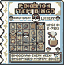

# Fortune's Favor

**Version:** 0.3.1

Adjust luck for encounters, fishing, shiny odds, the Game Corner and lottery tickets.

Features: adjustable luck, collection-aware wild and fishing picks, shiny odds, slot-machine luck, and tickets with money or candy prizes. NORMAL keeps the vanilla luck paths.

 

**Tested device:** Steam Deck (SteamOS Desktop Mode). Red, Blue and Yellow were tested in the installed configuration. Other devices are untested.

**Download:** [Version 0.3.1](https://github.com/kaboggs/fortunes-favor-mod/releases/tag/v0.3.1).

**Install:** See [INSTALL.md](INSTALL.md) for the guided script and manual steps. [DEPENDENCIES.md](DEPENDENCIES.md) lists fixed versions.

Companion mods: [Bill's Archive](https://github.com/kaboggs/bills-archive-mod), [Mini](https://github.com/kaboggs/dramatic-mini-modifications-mod), [Fortune's Favor](https://github.com/kaboggs/fortunes-favor-mod), [Deck Tilt](https://github.com/kaboggs/deck-tilt-mod).

**License:** Your use, modifications and redistribution of this project are permitted under [MIT](LICENSE), with the copyright and licence notice retained. Third-party components retain their own terms; see [notices](notices/).

---

Unofficial community mod; not affiliated with or endorsed by Nintendo, Game Freak, or The Pokémon Company. Use your own lawfully obtained, compatible game backups. No ROMs or extracted game assets are included. Third-party components retain their original notices and applicable terms. Provided as-is, without warranty; this notice does not grant rights to third-party material.
